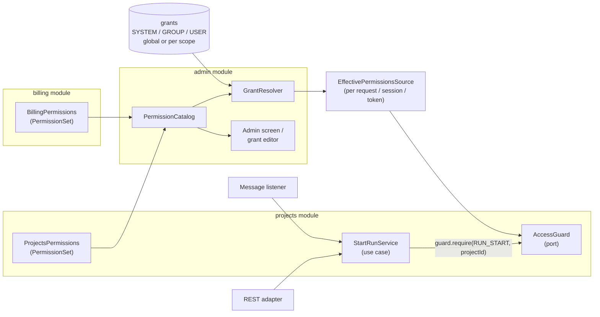

# port-permissions

Authorization for hexagonal (ports and adapters) Kotlin applications, built on three ideas:

1. **Modules expose their permissions.** Each module declares what it protects, in code, next to its use cases.
2. **Permissions are checked on the inbound port.** Every use case states the permission it needs, so the check holds for every adapter that drives it, and an architecture rule makes forgetting it a red build.
3. **Permissions are collected centrally for management.** A catalog assembled from all modules feeds the admin screen and validates grants, without the admin module importing anything from the others.

The library is small on purpose. The point is the architecture; the code just makes it hard to get wrong.

## Why

A common setup puts authorization in the web layer: `@PreAuthorize("hasAuthority('invoice:issue')")` on a controller method. In a hexagonal application this has three problems:

- **The check guards one adapter, not the use case.** A message listener, a scheduled job or a CLI calling the same inbound port skips it.
- **Permissions are loose strings.** A typo compiles, a removed permission lingers in the database, and nobody has the full list.
- **The management screen needs that full list.** Usually someone hard-codes it in the admin module, which then has to change every time another module adds a permission.

Annotations interpreted by AOP (`@Requires("run.start", scope = "#cmd.projectId")`) are not the answer either: they hide the check, need a framework in the core and cannot use ids that become known only inside the use case.

## The concept



### 1. Modules expose permissions

```kotlin
val PROJECT = ScopeType<ProjectId>("project", key = { it.value.toString() }, parse = { ProjectId(UUID.fromString(it)) })

object ProjectsPermissions : PermissionSet("projects") {
    val PROJECTS_CREATE = permission("projects.create", "Create projects")    // Permission - global
    val RUN_START = scoped("run.start", "Start and retry runs", PROJECT)      // ScopedPermission<ProjectId>
    val RUN_VIEW = scoped("run.view", "View runs", PROJECT)
}
```

Keys are `module.name` (`projects.run.start`). A permission can only be created through a `PermissionSet`, so anything a use case can require is, by construction, in the catalog.

A **scoped** permission is held per resource - "start runs on project X". Its scope type is part of its declaration: `ScopeType` gives the scope a name (shown on the admin screen) and the two conversions between the consumer's id type and the string stored in grants. Any id type works - a value class, a `UUID`, an `Int`.

### 2. Use cases check on the port

```kotlin
class StartRunService(
    private val guard: AccessGuard,
    private val runs: RunRepository,
) : StartRun {
    override fun start(command: StartRunCommand): RunId {
        guard.require(ProjectsPermissions.RUN_START, command.projectId)
        // ...
    }
}
```

`AccessGuard` is a port: the application core depends on it, not on Spring Security. Misuse does not compile:

```kotlin
guard.require(PROJECTS_CREATE)            // ok
guard.require(RUN_START, projectId)        // ok
guard.require(RUN_START)                   // compile error: a scoped permission needs a scope
guard.require(RUN_START, teamId)           // compile error: scope of another type
guard.require(PROJECTS_CREATE, projectId)  // compile error: a global permission takes no scope
```

A failed check throws `PermissionDeniedException` (403) carrying the permission and the scope key; no authenticated principal throws `NotAuthenticatedException` (401).

#### Filtering lists by scope

```kotlin
override fun list(): List<Run> =
    when (val filter = guard.scopesWith(ProjectsPermissions.RUN_VIEW)) {
        ScopeFilter.All -> runs.findAll()                                   // e.g. an admin of all projects
        is ScopeFilter.AllExcept -> runs.findByProjectNotIn(filter.excluded) // global grant, revoked on some
        is ScopeFilter.Only -> runs.findByProjectIn(filter.ids)              // empty: nothing visible
    }
```

In SQL that is no condition, `project_id NOT IN (...)` and `project_id IN (...)`. Both lists are usually short. With thousands of ids, pass them as an array parameter (`= ANY(:ids)` in PostgreSQL) or join a temporary table instead of building a huge `IN` list. Remember that `NOT IN` never matches rows where `project_id` is null.

### 3. Central catalog for management

```kotlin
val catalog = PermissionCatalog(listOf(ProjectsPermissions, BillingPermissions))

catalog.modules              // permissions grouped by module; each has `scope`: null (global) or e.g. "project"
catalog.ensureValid(grants)  // fail fast before storing grants: unknown keys, scope on a global permission, malformed scope key
```

Code is the source of truth. The catalog is built in memory at startup and never persisted; only **grants** live in the database. Two modules declaring the same key stop the application from starting (`DuplicatePermissionException`).

#### Grants and precedence

Grants work on three levels, and a scoped permission can be granted on one scope or, without a scope, on every scope:

```kotlin
Grant("projects.run.start", GrantLevel.GROUP, granted = true)                    // every project
Grant("projects.run.start", GrantLevel.USER, granted = false, scope = "p-9")      // except p-9 for this user
```

| Level    | Meaning                                    |
|----------|--------------------------------------------|
| `SYSTEM` | default for everyone                       |
| `GROUP`  | overrides the default for a group          |
| `USER`   | overrides both for one person              |

For a permission on a given scope, the candidates are the grants without a scope and the grants for that scope. **The most specific level wins; on the same level the scoped grant wins.** So a USER-level revocation without a scope switches the permission off everywhere, while a GROUP grant on every project plus a USER revocation on `p-9` gives "every project except `p-9`". Opposite decisions on the same level and with the same specificity, typically from two groups of one user, are not an error: by default **the revocation wins**. `GrantResolver(catalog, SameLevelConflict.GRANT_WINS)` switches to the union of group permissions. No grant at all means no permission. Grants that no longer match the catalog are ignored, so removing a permission from code does not break login.

```kotlin
val effective: EffectivePermissions = GrantResolver(catalog).resolve(grantsOfUser)
```

**Roles stay out of the library.** Map your roles, groups and memberships to grants (or straight to `EffectivePermissions`) on your side.

## Effective permissions: choosing how fresh they are

The guard asks one port - `EffectivePermissionsSource` - for the current principal's `EffectivePermissions`. The strategy behind it is yours:

| Strategy | How | Revocation takes effect | Use for |
|---|---|---|---|
| Per request | `EffectivePermissionsSource { currentUserId()?.let { resolver.resolve(grantsOf(it)) } }` | immediately | low traffic, or when every request must be fresh |
| **Session cache with invalidation** | `SessionCachedPermissions` | on the next request after an invalidation | **session and BFF applications - the recommended default** |
| Token | resolve at login, carry the snapshot in a short-lived token, expose it through `PermissionsPrincipal` | when the token expires | stateless services |

Why the session cache is the default for session apps: it resolves grants once per session instead of once per request, yet a revocation is not delayed until logout. When grants, roles or memberships change, bump the principal's version; the next request sees a different version and resolves again.

```kotlin
val versions = InMemoryPermissionVersions()   // single instance only, see below
val source = SessionCachedPermissions(
    principalId = { currentUserId() },
    slot = HttpSessionSlot(),                  // yours: get/put one attribute of the HTTP session
    versions = versions,
    resolve = { id -> resolver.resolve(grants.of(id)) },
)

// in the use case that changes grants:
versions.invalidate(userId)   // or invalidateAll() after changing a group's grants
```

`InMemoryPermissionVersions` works for one application instance. **With several instances the version must live in shared storage**, for example a `permissions_version` column on the user row, incremented in the same transaction as the grant change - implement `PermissionVersions` on top of it. A `SessionSlot` over the servlet session is a few lines:

```kotlin
class HttpSessionSlot : SessionSlot {
    private fun session() = (RequestContextHolder.currentRequestAttributes() as ServletRequestAttributes).request.getSession(true)
    override fun get() = session().getAttribute("effective-permissions") as CachedPermissions?
    override fun put(value: CachedPermissions) = session().setAttribute("effective-permissions", value)
}
```

### Principal kinds

`EffectivePermissions.principal` says who is calling: `USER`, `DELEGATED` (a token acting on behalf of a user), `MACHINE` (a machine or CI token) or `SYSTEM`. It is information for logs and audit; the only kind-specific helper is `narrowedTo`, which gives a delegated token exactly what both the user and the token's capabilities allow:

```kotlin
val delegated = userPermissions.narrowedTo(EffectivePermissions.of(RUN_START on projectId))
val machine = EffectivePermissions.of(RUN_START on projectId, principal = PrincipalKind.MACHINE)
```

### Exposing permissions to a frontend

`EffectivePermissions` is a plain data class of strings, booleans, sets and maps, so it can be returned as is, e.g. from `GET /me`:

```json
{
  "principal": "USER",
  "global": ["projects.projects.create"],
  "scoped": {
    "projects.run.start": { "all": false, "only": ["p-1", "p-2"], "except": [] },
    "projects.run.view":  { "all": true,  "only": [], "except": ["p-9"] }
  }
}
```

The frontend uses it only to show or hide controls. **It is never a security decision** - the use case checks again.

## Public and system operations

Not every operation needs a permission. Two annotations mark the exceptions, each with a mandatory reason:

| | `@PublicOperation(reason)` | `@SystemOperation(reason)` |
|---|---|---|
| Who runs it | any authenticated caller | only the application itself: schedulers, queue workers, callbacks of internal components, startup seeding |
| User involved | yes | no |
| Runtime check | none | `guard.requireSystem()` as the first step |
| Reachable from user-facing adapters | yes | never - it implements a separate system port |

```kotlin
// application/port/inbound/system/PurgeRuns.kt - a system port
class PurgeRunsService(private val guard: AccessGuard, ...) : PurgeRuns {
    @SystemOperation("Nightly retention")
    override fun purge() {
        guard.requireSystem()
        // ...
    }
}

// adapter/inbound/scheduler/PurgeJob.kt
fun nightly() = guard.asSystem("nightly retention") { purgeRuns.purge() }
```

`asSystem` runs the block as the system principal, which **holds no permissions**: inside it `require(...)` fails and only `requireSystem()` passes. It is therefore not a way to escalate - a user path that wanders into `asSystem` gains nothing. `asSystem` is bound to the current thread, like Spring's `SecurityContext`; work handed to another thread or a coroutine dispatcher inside the block does not run as the system.

Domain rules stay in the domain. A system use case is only the application-level entry point for work nobody asked for in person.

## Deny by default: architecture rules

Explicit checks have one weakness: forgetting one fails silently. Two modules turn that into a red build.

### `port-permissions-archunit` (recommended)

Checks bytecode with ArchUnit:

```kotlin
private val classes = ClassFileImporter().importPackages("com.example")
private val rules = PortPermissionsRules(
    inboundPorts = listOf("..application.port.inbound.."),          // defaults shown
    services = listOf("..application.."),
    systemPorts = listOf("..application.port.inbound.system.."),
    userFacingAdapters = listOf("..adapter.inbound.web..", "..adapter.inbound.rest.."),
)

@TestFactory
fun `authorization rules`() = rules.all().map { rule -> DynamicTest.dynamicTest(rule.description) { rule.check(classes) } }
```

| Rule | What it enforces |
|---|---|
| `operationsAreGuarded()` | every **operation** - a public method of a class in `services` that implements a method of an inbound port - calls `require(...)` or `requireSystem()` on an `AccessGuard`, or carries `@PublicOperation` / `@SystemOperation` |
| `systemOperationsRequireSystem()` | every `@SystemOperation` calls `requireSystem()`, so the annotation is backed by a runtime check |
| `systemOperationsLiveInSystemPorts()` | `@SystemOperation` exactly on implementations of system ports |
| `systemPortsAreNotReachableFromUserFacingAdapters()` | web and REST adapters do not depend on system ports |

A call counts when it is made directly in the operation or in a lambda the operation creates, one level deep - so `transactionTemplate.execute { guard.require(...) }` is seen. A check inside a helper method or a lambda nested in another lambda is not; keep the check at the top of the operation. A Kotlin package written `` port.`in` `` is `port.in` in bytecode: configure `inboundPorts = listOf("..port.in..")`.

### `port-permissions-konsist`

```kotlin
GuardedUseCases.assertGuarded(Konsist.scopeFromProduction())
```

Works on source code: every overriding function in `..application.usecase..` must call `require(...)` / `requireSystem()` on a constructor parameter or property typed as an access guard, or carry an exemption annotation. Source analysis has no type resolution, so this is an approximation. Prefer the ArchUnit rules.

Neither rule can see the **order** of a check and a write, or a check on the wrong permission. That is what the test kit is for.

## Test kit: `port-permissions-test`

```kotlin
// guards with fixed permissions (in core)
AccessGuard.allowing(PROJECTS_CREATE, RUN_START on projectA, RUN_VIEW.everywhere)
AccessGuard.denyingAll()

// what exactly was checked
val guard = RecordingAccessGuard()
service.start(StartRunCommand(projectA))
guard.checks shouldBe listOf(RecordedCheck.of(RUN_START on projectA))

// guarded by the right check, before any side effect
assertGuardedBy(RUN_START on projectA, touched = { runs.saved.isNotEmpty() }) { guard ->
    StartRunService(guard, runs).start(StartRunCommand(projectA))
}

// a system operation refuses to run outside asSystem
assertSystemOnly(touched = { runs.purged }) { guard -> PurgeRunsService(guard, runs).purge() }
```

`assertGuardedBy` runs the operation twice: with a guard denying everything, and with a guard granting everything **except** the expected permission and scope. Both runs must fail on exactly that check with the probe untouched. That catches a missing check, a check placed after a write, and a check on the wrong permission or scope - none of which a static rule can see.

## Modules

| Artifact                    | Dependencies          | Contents                                                                                      |
|-----------------------------|-----------------------|-----------------------------------------------------------------------------------------------|
| `port-permissions-core`     | Kotlin stdlib only    | permissions and scopes, `PermissionCatalog`, `AccessGuard`, `GrantResolver`, sources, annotations |
| `port-permissions-spring`   | Spring Boot, Security | auto-configuration collecting all `PermissionSet` beans, guard over the security context      |
| `port-permissions-archunit` | ArchUnit              | `PortPermissionsRules` - deny by default on bytecode (recommended)                            |
| `port-permissions-konsist`  | Konsist               | `GuardedUseCases` - deny by default on source                                                 |
| `port-permissions-test`     | -                     | `RecordingAccessGuard`, `assertGuardedBy`, `assertSystemOnly`                                 |

### With Spring Boot

Each module registers its set in its own configuration:

```kotlin
@Configuration
class ProjectsConfig {
    @Bean
    fun projectsPermissions(): PermissionSet = ProjectsPermissions
}
```

The auto-configuration provides `PermissionCatalog`, `GrantResolver` and an `AccessGuard` over an `EffectivePermissionsSource`. Define your own `EffectivePermissionsSource` bean to choose the strategy. Without one, the guard reads the security context: a principal implementing `PermissionsPrincipal` supplies its snapshot, scopes included; otherwise the authorities are read as global permission keys, with an optional prefix from `port-permissions.authority-prefix` (e.g. `PERM_`). Authorities cannot carry scopes. Define your own `AccessGuard` bean to replace the guard entirely.

## Design decisions

- **Check in the use case, not in the controller.** One place, every adapter, no framework in the core. The cost is an explicit line in each operation, which the architecture rules keep honest.
- **Typed permissions over strings.** `require` takes a `Permission` or a `ScopedPermission<S>` with an `S`, so a typo, a missing scope or a scope of the wrong type does not compile. Strings remain only at the edges: in stored grants and in snapshots.
- **Catalog in code, grants in the database.** Adding a permission is a code change reviewed with the feature that needs it; there is no migration that inserts catalog rows. The price is no foreign key between grants and the catalog, hence `ensureValid` on write and filtering on resolve.
- **Freshness is a choice, not a given.** One port, three strategies; the session cache with invalidation is the default for session apps.
- **The system holds no permissions.** System work goes through dedicated system ports and `requireSystem()`, never through a principal that may do everything.
- **Independent permissions.** A permission does not imply another one, e.g. `edit` does not include `view`. Grant both when both are needed.

## Roadmap

- Dependent permissions declared in the catalog (`edit` requires `view`), resolved by `GrantResolver`.
- A Spring Boot Actuator endpoint exposing the catalog.

## Installation

Releases are built by [JitPack](https://jitpack.io) from Git tags:

```kotlin
repositories {
    maven("https://jitpack.io")
}

dependencies {
    implementation("com.github.Osucha.port-permissions:port-permissions-core:0.2.1")
    implementation("com.github.Osucha.port-permissions:port-permissions-spring:0.2.1")        // optional
    testImplementation("com.github.Osucha.port-permissions:port-permissions-test:0.2.1")      // optional
    testImplementation("com.github.Osucha.port-permissions:port-permissions-archunit:0.2.1")  // optional
}
```

Upgrading from 0.1.0: see [CHANGELOG.md](CHANGELOG.md).

## Compatibility

JDK 21. Compiled for Kotlin 2.3 metadata, so consumers on Kotlin 2.3 or newer can use it; CI compiles a sample consumer (`consumer-check/`) with Kotlin 2.3.

## Building

```shell
./gradlew build
./gradlew publishToMavenLocal && ./gradlew -p consumer-check build   # Kotlin 2.3 consumer
```

## License

[Apache License 2.0](LICENSE)
