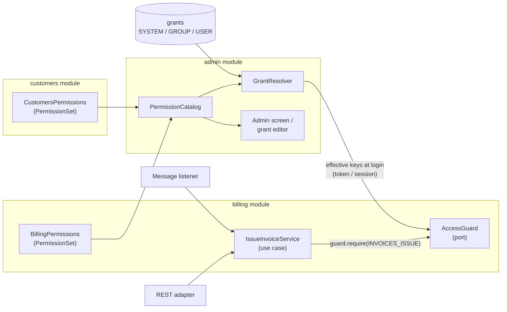

# port-permissions

Authorization for hexagonal (ports and adapters) Kotlin applications, built on three ideas:

1. **Modules expose their permissions.** Each module declares what it protects, in code, next to its use cases.
2. **Permissions are checked on the inbound port.** Every use case states the permission it needs, so the check holds for every adapter that drives it, and an architecture rule makes forgetting it a red build.
3. **Permissions are collected centrally for management.** A catalog assembled from all modules feeds the admin screen and validates grants, without the admin module importing anything from the others.

The library is small on purpose. The point is the architecture; the code just makes it hard to get wrong.

## Why

A common setup puts authorization in the web layer: `@PreAuthorize("hasAuthority('invoice:issue')")` on a controller method. In a hexagonal application this has three problems:

- **The check guards one adapter, not the use case.** A message listener, a scheduled job or a CLI calling the same inbound port skips it.
- **Permissions are loose strings.** A typo compiles, a removed permission lingers in the database, and nobody has the full list.
- **The management screen needs that full list.** Usually someone hard-codes it in the admin module, which then has to change every time another module adds a permission.

## The concept



### 1. Modules expose permissions

```kotlin
object BillingPermissions : PermissionSet("billing") {
    val INVOICES_VIEW = permission("invoices.view", "View invoices")
    val INVOICES_ISSUE = permission("invoices.issue", "Issue invoices")
}
```

Keys are `module.name` (`billing.invoices.issue`). A `Permission` can only be created through a `PermissionSet`, so anything a use case can require is, by construction, in the catalog. The module owns its permissions the same way it owns its use cases.

### 2. Use cases check on the port

```kotlin
class IssueInvoiceService(
    private val guard: AccessGuard,
    private val invoices: InvoiceRepository,
) : IssueInvoice {
    override fun issue(command: IssueInvoiceCommand): InvoiceId {
        guard.require(BillingPermissions.INVOICES_ISSUE)
        // ...
    }
}
```

`AccessGuard` is a port: the application core depends on it, not on Spring Security. The check is explicit and visible in the use case, and it holds whichever adapter calls the port.

Explicit checks have one weakness: forgetting one fails silently. The rule from `port-permissions-konsist` fixes that by making the default "deny":

```kotlin
@Test
fun `every use case operation is guarded`() {
    GuardedUseCases.assertGuarded(Konsist.scopeFromProduction())
}
```

Every overriding function of a class in `..application.usecase..` must call `require(...)` or carry `@PublicOperation`. The annotation takes a mandatory reason, so every exemption is explained where it is made:

```kotlin
@PublicOperation("Runs on a schedule, without a user")
override fun verifyAll() { /* ... */ }
```

### 3. Central catalog for management

```kotlin
val catalog = PermissionCatalog(listOf(BillingPermissions, CustomersPermissions))

catalog.modules          // permissions grouped by module, for the admin screen
catalog.ensureKnown(keys) // fail fast before storing grants (UnknownPermissionException)
```

Code is the source of truth. The catalog is built in memory at startup and never persisted; only **grants** live in the database. Two modules declaring the same key stop the application from starting (`DuplicatePermissionException`).

Grants work on three levels, from the least to the most specific:

| Level    | Meaning                                    |
|----------|--------------------------------------------|
| `SYSTEM` | default for everyone                       |
| `GROUP`  | overrides the default for a group          |
| `USER`   | overrides both for one person              |

```kotlin
val effective: Set<String> = GrantResolver(catalog).resolve(grantsOfUser)
```

For each permission the most specific grant wins, and the permission is effective only if that grant says `granted`. A user can therefore have a permission revoked even though their group has it. No grant at any level means no permission. Grants for keys that no longer exist in code are ignored.

Resolve once at login and put the effective keys in the token or session. A check is then an in-memory lookup, with no database round trip and no call to the admin module.

## Modules

| Artifact                   | Dependencies         | Contents                                                                                 |
|----------------------------|----------------------|------------------------------------------------------------------------------------------|
| `port-permissions-core`    | Kotlin stdlib only   | `PermissionSet`, `PermissionCatalog`, `AccessGuard`, `GrantResolver`, `@PublicOperation` |
| `port-permissions-spring`  | Spring Boot, Security | auto-configuration collecting all `PermissionSet` beans, `SecurityContextAccessGuard`    |
| `port-permissions-konsist` | Konsist              | `GuardedUseCases` architecture rule (deny by default)                                    |

### With Spring Boot

Each module registers its set in its own configuration:

```kotlin
@Configuration
class BillingConfig {
    @Bean
    fun billingPermissions(): PermissionSet = BillingPermissions
}
```

The auto-configuration provides `PermissionCatalog`, `GrantResolver` and an `AccessGuard` that reads permission keys from the authorities of the current `Authentication` (optionally with a prefix such as `PERM_`). An anonymous or missing authentication raises `NotAuthenticatedException` (401), a missing permission raises `PermissionDeniedException` (403). Define your own `AccessGuard` bean to replace the default.

### In use case tests

```kotlin
val service = IssueInvoiceService(AccessGuard.allowing(BillingPermissions.INVOICES_ISSUE), invoices)
```

## Design decisions

- **Check in the use case, not in the controller.** One place, every adapter, no framework in the core. The cost is an explicit line in each operation, which the architecture rule keeps honest.
- **Typed permissions over strings.** `require` takes a `Permission`, not a `String`, so a typo or a permission outside the catalog does not compile. Strings remain only at the edges: in stored grants and in tokens.
- **Catalog in code, grants in the database.** Adding a permission is a code change reviewed with the feature that needs it; there is no migration that inserts catalog rows. The price is no foreign key between grants and the catalog, hence `ensureKnown` on write and filtering on resolve.
- **Effective permissions travel with the principal.** Resolution happens at login. A change of grants takes effect at the next login or token refresh.
- **Independent permissions.** A permission does not imply another one, e.g. `edit` does not include `view`. Grant both when both are needed.

## Roadmap

- Dependent permissions declared in the catalog (`edit` requires `view`), resolved by `GrantResolver`.
- A Spring Boot Actuator endpoint exposing the catalog.

## Installation

Releases are built by [JitPack](https://jitpack.io) from Git tags:

```kotlin
repositories {
    maven("https://jitpack.io")
}

dependencies {
    implementation("com.github.Osucha.port-permissions:port-permissions-core:0.1.0")
    implementation("com.github.Osucha.port-permissions:port-permissions-spring:0.1.0") // optional
    testImplementation("com.github.Osucha.port-permissions:port-permissions-konsist:0.1.0") // optional
}
```

## Building

```shell
./gradlew build
```

Requires JDK 21.

## License

[Apache License 2.0](LICENSE)
